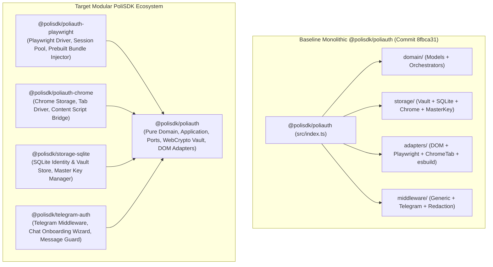

# Phase 0 — Baseline Architecture Audit, Dependency Map & Package Ownership Plan

## 1. Baseline Re-Scan Validation

A complete line-by-line scan of `packages/poliauth` at baseline commit `8fbca31` confirms all architectural findings from the initial audit and establishes the baseline for the 5-phase refactoring.

### Verified Baseline Issues
1. **Runtime Barrel Coupling**:
   - `src/index.ts` re-exports `storage/index.ts`, `adapters/index.ts`, and `middleware/index.ts`.
   - `storage/index.ts` statically imports `better-sqlite3`, `node:fs`, `node:path`, and `node:crypto` via `sqlite-storage.ts` and `master-key.ts`.
   - `adapters/index.ts` statically imports `esbuild`, `node:fs`, `node:path`, `node:url`, and dynamic `playwright` via `injected-auth-bundle.ts` and `playwright-session-pool.ts`.
2. **Undeclared Runtime Dependency**:
   - `adapters/injected-auth-bundle.ts` imports `esbuild` at runtime without `esbuild` declared in `packages/poliauth/package.json`.
3. **Mixed Platform Cryptography (`storage/vault.ts`)**:
   - Credential encryption uses Web Crypto (`crypto.subtle` PBKDF2 + AES-GCM), while session state encryption in the same file uses `node:crypto` (`createCipheriv`, `createDecipheriv`, `createHash`, `randomBytes`) and Node `Buffer`.
4. **Polirecord & Telegram Contamination**:
   - Storage constants: `polirecord_secure_vault_v1`, `polirecord_vault_meta_v1`, `polirecord_playwright_storage_state_v1`.
   - Key derivation prefixes: `PoliRecord::VaultKey::v1::`, `PoliRecord::StorageState::`, `polirecord-local-dev-vault-key`, `polirecord-telegram-bot-user-`.
   - SQLite schema columns: `telegram_user_id`, `telegram_username`, `onboarding_done`, `default_delivery_mode TEXT NOT NULL DEFAULT 'telegram'`.
   - Domain & UI leaks: `promptMessageId` in `domain/credential-wizard.ts`, `'Run /login to try again.'` in `domain/otp-challenge.ts`, `TELEGRAM_BOT_TOKEN_REGEX` and `recordingViewerInfoToken`/`RCID` in `middleware/redaction.ts`, and `middleware/telegram-middleware.ts`.
5. **Service-Specific Navigation Coupled to Authentication**:
   - `domain/entities.ts`, `domain/login-flow-spec.ts`, `domain/service-registry.ts`, `domain/login-orchestrator.ts`, and `adapters/polimi-dom-adapter.ts` couple authentication to launching target portal services (`RECORDINGS_ARCHIVE_SERVICE` `2314`, `WEBEEP_SERVICE` `2166`, `'archive'`, `'opening_recording_archives'`).
6. **Domain / Application Layer Conflation**:
   - Stateful application orchestrators (`PoliAuthOrchestrator`, `OtpChallengeCoordinator`, `CredentialSetupWizard`, `AuthorizationService`) reside inside `domain/` alongside pure domain models and specifications.
7. **Interface Segregation Violations**:
   - `AuthPageDriverPort` hardcodes federated email SSO methods (`inspectFederatedSsoPage`, `submitFederatedEmailLogin`) and Webex-specific assumptions (`webexAuthenticatedSelector`).

---

## 2. Baseline vs. Target Dependency Map

---

## 3. Target Package Ownership Map

| Package | Owned Responsibilities | Forbidden Dependencies |
| :--- | :--- | :--- |
| **`@polisdk/poliauth`** | Core domain models (`IdentityId`, `LoginCredentials`, `UserIdentity`), credential validation/masking, RFC 6238 TOTP (`crypto.subtle`), PoliMi SSO protocol specification, application use cases (`PoliAuthOrchestrator`, `OtpChallengeCoordinator`, `CredentialSetupWizard`, `AuthorizationService`), ports (`interfaces/`), pure Web Crypto `EncryptedCredentialVault` + `InMemory` stores, pure PoliMi & Federated SAML DOM adapters, generic auth middleware & secret redaction. | `better-sqlite3`, `playwright`, `esbuild` (runtime), `node:fs`, `node:path`, `node:url`, `node:crypto`, `Buffer`, `chrome.*`, Telegram APIs, service-navigation scrapers. |
| **`@polisdk/poliauth-playwright`** | `PlaywrightAuthPageDriver`, `PlaywrightBrowserSessionPool`, and prebuilt browser adapter script injection (`ensureAuthAdaptersInjected`). | `better-sqlite3`, `chrome.*`, Telegram APIs. |
| **`@polisdk/poliauth-chrome`** | `ChromeLocalVaultStorage`, `ChromeExtensionTabDriver`, and content-script message bridge for MV3 browser extensions. | `better-sqlite3`, `playwright`, `node:*`, Telegram APIs. |
| **`@polisdk/storage-sqlite`** | `PoliAuthSqliteDatabase` (generic `user_id` schema), `SqliteVaultStorageBackend`, `SqliteUserVaultStorageFactory`, `SqliteSessionStateStore`, and `resolveMasterEncryptionKey`. | `playwright`, `chrome.*`, Telegram APIs, `polirecord_*` naming. |
| **`@polisdk/telegram-auth`** | `createTelegramAuthMiddleware`, `deleteSensitiveTelegramMessage`, Telegram bot token redaction pattern, and chat-aware credential setup workflow helpers. | `better-sqlite3`, `playwright`, `chrome.*`. |

---

## 4. Phased Execution Plan

1. **Phase 1 — Purify `@polisdk/poliauth` Core**:
   - Remove SQLite, Playwright, Chrome Extension, Telegram, and Node filesystem/crypto modules from `@polisdk/poliauth`.
   - Standardize `storage/vault.ts` on 100% Web Crypto (`crypto.subtle` PBKDF2-HMAC-SHA256 + AES-256-GCM) for both credentials and session states.
   - Purge all `polirecord_*` / `PoliRecord::*` / `telegram_user_id` / `archive` naming and decouple authentication from portal service navigation so authentication stops at an authenticated PoliMi session.
2. **Phase 2 — Separate `application/` Layer from `domain/` Layer**:
   - Move `login-orchestrator.ts`, `otp-challenge.ts`, `credential-wizard.ts`, and `authorization.ts` into `packages/poliauth/application/`.
   - Keep `packages/poliauth/domain/` strictly limited to pure models, validation rules, TOTP specification, and SSO flow specifications.
3. **Phase 3 — Extract Infrastructure & Delivery Packages**:
   - Create and test `@polisdk/poliauth-playwright`, `@polisdk/poliauth-chrome`, `@polisdk/storage-sqlite`, and `@polisdk/telegram-auth`.
4. **Phase 4 — Interface & Extensibility Review**:
   - Segregate `AuthPageDriverPort` into core PoliMi IdP driver capabilities vs. pluggable `FederatedSsoProviderAdapterPort` / `FederatedSsoDriverPort` so Webex is just one extensible SAML SP implementation rather than hardcoded on the core driver port.
5. **Phase 5 — Final Architecture Validation**:
   - Verify complete dependency isolation, SOLID compliance, documentation accuracy, and final architecture scorecard.
