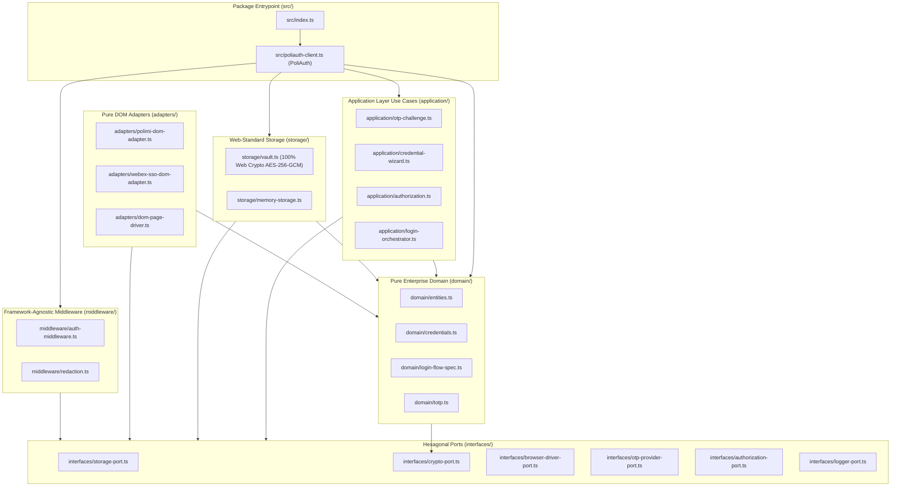

# Architecture & Boundary Purification Report (`@polisdk/poliauth`)

## 1. Executive Summary

`@polisdk/poliauth` is the standalone authentication core of the **PoliSDK** platform. In Phases 1 and 2, all legacy application coupling, runtime-specific infrastructure (`better-sqlite3`, `playwright`, `chrome.*`, `esbuild`, `node:fs`, `node:crypto`), Telegram bot assumptions, and downstream portal service navigation concerns were purged, and stateful use cases were cleanly separated into `application/` distinct from `domain/`.

---

## 2. Layered Dependency Graph (`domain/` vs. `application/`)

---

## 3. Domain vs. Application Layer Separation

| Layer | Directory | Files | Responsibilities |
| :--- | :--- | :--- | :--- |
| **Enterprise Domain** | `domain/` | `entities.ts`, `credentials.ts`, `totp.ts`, `login-flow-spec.ts` | Stateless models, value objects, credential validation/masking rules, RFC 6238 TOTP computation, and PoliMi SSO protocol specification. |
| **Application Use Cases** | `application/` | `login-orchestrator.ts`, `otp-challenge.ts`, `credential-wizard.ts`, `authorization.ts` | Stateful workflow orchestration (`PoliAuthOrchestrator`), asynchronous 2FA challenge coordination (`OtpChallengeCoordinator`), onboarding wizard state machine (`CredentialSetupWizard`), and RBAC/resource authorization (`AuthorizationService`). |
