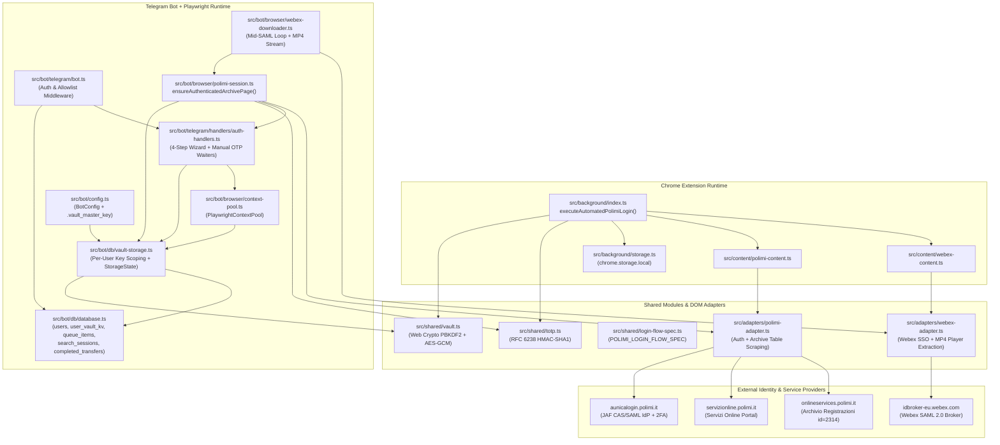

# Phase 1: Architecture Analysis & Coupling Report (`polirecord` → `@polisdk/poliauth`)

## 1. Executive Summary of the Original Authentication Architecture

In `polirecord`, authentication, 2FA (TOTP + manual OTP), session management, credential encryption, and federated SAML 2.0 Single Sign-On (SSO) evolved across two separate runtime targets within the same repository:

1. **Manifest V3 Chrome Extension (`src/background/`, `src/content/`, `src/ui/`)**:
   - Single-user runtime storing AES-256-GCM encrypted credentials in `chrome.storage.local`.
   - Orchestrated the 5-stage PoliMi login pipeline (`executeAutomatedPolimiLogin` in `src/background/index.ts`) via message passing (`chrome.tabs.sendMessage`) to content scripts (`src/content/polimi-content.ts`, `src/content/webex-content.ts`).
2. **Multi-User Headless Playwright Telegram Bot (`src/bot/`)**:
   - Multi-tenant Node.js service storing per-user encrypted credentials and Playwright `storageState` blobs in SQLite (`users` and `user_vault_kv` tables in `src/bot/db/database.ts`).
   - Re-implemented its own 5-stage PoliMi login state machine (`ensureAuthenticatedArchivePage` in `src/bot/browser/polimi-session.ts`) and a third mid-SAML login loop inside `WebexPlaywrightDownloader` (`src/bot/browser/webex-downloader.ts`).

---

## 2. Original System Dependency Graph

The diagram below illustrates how authentication logic in `polirecord` was tightly interwoven with course recording scraping, MP4 downloading, queue management, SQLite tables, and Telegram UI handlers:

---

## 3. Identified Coupling Points & Architectural Bottlenecks

| # | Coupling Area | Files Involved in `polirecord` | Architectural Problem |
|---|---|---|---|
| **1** | **Triplicated 5-Stage Login State Machine** | `src/background/index.ts`, `src/bot/browser/polimi-session.ts`, `src/bot/browser/webex-downloader.ts` | Three separate `for` loops implemented the exact same Stage 0 → Stage 4 PoliMi authentication state machine with slightly diverging retry, timeout, and error-handling behavior. |
| **2** | **DOM Adapters Mixed Auth with Course Scraping** | `src/adapters/polimi-adapter.ts`, `src/adapters/webex-adapter.ts` | `polimi-adapter.ts` mixed JAF login/2FA/portal navigation with Recordings Archive table pagination (`extractAcademicYears`, `collectAllArchivePages`). `webex-adapter.ts` mixed SAML SSO (`#IDToken1`/`#IDButton2`) with Webex MP4 player extraction (`#playerDownload_<uuid>`). |
| **3** | **Hardcoded Service ID (`idServizio=2314`)** | `src/shared/login-flow-spec.ts`, `src/adapters/polimi-adapter.ts` | Portal navigation was hardcoded to Recording Archives (`idServizio=2314`), preventing reuse for other PoliMi services (`WeBeep` `2166`, Career/Exams, etc.). |
| **4** | **Global Mutation for Per-User Vault Encryption** | `src/bot/db/vault-storage.ts`, `src/shared/vault.ts` | Because `src/shared/vault.ts` derived keys from `chrome.runtime.id`, `vault-storage.ts` temporarily mutated `globalThis.chrome.runtime.id` inside a mutex before calling `saveEncryptedCredentials`/`loadEncryptedCredentials`. |
| **5** | **Monolithic SQLite Schema & Repository** | `src/bot/db/database.ts` | `BotDatabase` combined identity/vault tables (`users`, `user_vault_kv`) with application-specific tables (`search_sessions`, `queue_items`, `completed_transfers`, `telegram_file_cache`) and coupled `telegram_user_id: number` everywhere. |
| **6** | **Telegram-Coupled Wizard & Manual OTP Waiters** | `src/bot/telegram/handlers/auth-handlers.ts` | The 4-step credential onboarding state machine and the asynchronous `pendingManualOtpWaiters` registry were embedded directly inside `grammY` handler closures. |
| **7** | **Browser Context Pool Coupled to `BotConfig` & `BotDatabase`** | `src/bot/browser/context-pool.ts` | `PlaywrightContextPool` required the full `BotConfig` and `BotDatabase` concrete classes in its constructor and bundled the entire `polimi-adapter` + `webex-adapter` (including scraper code). |

---

## 4. Strict Extraction Boundary: `@polisdk/poliauth` vs. `polirecord`

| Responsibility | Extracted to `@polisdk/poliauth` | Remains in `polirecord` (Application Layer) |
|---|---|---|
| **PoliMi JAF Login, Session Recovery & 2FA** | ✅ `PoliAuthOrchestrator`, `polimi-dom-adapter.ts`, `POLIMI_LOGIN_FLOW_SPEC` | ❌ Consumes `@polisdk/poliauth` |
| **Portal Service Discovery & Navigation** | ✅ `PolimiServiceRegistry` (`2314`, `376`, `2166`, custom services) | ❌ Passes `RECORDINGS_ARCHIVE_SERVICE` (`2314`) |
| **Webex Federated SAML 2.0 SSO (`doSSO.jsp`)** | ✅ `webex-sso-dom-adapter.ts`, `ensureFederatedSamlAuthenticated()` | ❌ Consumes `@polisdk/poliauth` before MP4 extraction |
| **RFC 6238 TOTP & Manual OTP Coordinator** | ✅ `TotpService`, `OtpChallengeCoordinator` | ❌ Wires Telegram reply prompt to `OtpChallengeCoordinator` |
| **Encrypted Credential & Session State Vault** | ✅ `EncryptedCredentialVault`, `SqliteVaultStorageBackend`, `ChromeLocalVaultStorage`, `InMemoryVaultStorage` | ❌ Consumes `@polisdk/poliauth/storage` |
| **Multi-User Playwright Session Pool** | ✅ `PlaywrightBrowserSessionPool` (`SessionContextPoolPort`) | ❌ Uses pool to run archive search & Webex downloads |
| **4-Step Credential Setup Wizard** | ✅ `CredentialSetupWizard` (`domain/credential-wizard.ts`) | ❌ Renders Telegram keyboards / UI messages |
| **RBAC, Allowlist & Resource Authorization** | ✅ `AuthorizationService`, `createAuthMiddleware`, `createTelegramAuthMiddleware` | ❌ Implements `ResourceAuthorizationPolicyPort` for `transferId` |
| **Secret Redaction (`__pj1`, `jaf_currentWFID`, etc.)** | ✅ `redactSecrets`, `createRedactingLogger` | ❌ Uses redaction helper in bot/extension logs |
| **Course Offerings & Recordings Table Scraping** | ❌ Excluded (Zero business logic leakage) | ✅ `polirecord` (`extractAcademicYears`, `collectAllArchivePages`, `resolvePlayUrlFromDom`) |
| **Webex MP4 Stream & HLS Download Pipeline** | ❌ Excluded | ✅ `polirecord` (`WebexPlaywrightDownloader`, `#playerDownload_<uuid>`, `ffmpeg`) |
| **Download Queue & Telegram File Cache** | ❌ Excluded | ✅ `polirecord` (`BotQueueManager`, `queue_items`, `telegram_file_cache`) |
