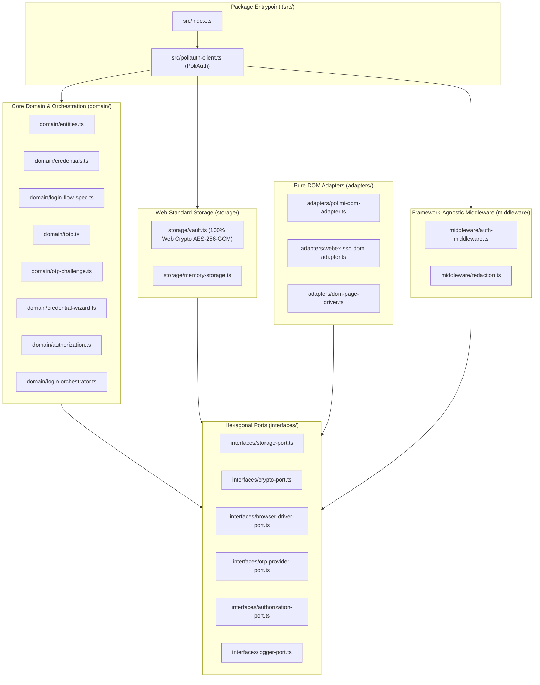

# Architecture & Boundary Purification Report (`@polisdk/poliauth`)

## 1. Executive Summary

`@polisdk/poliauth` is the standalone authentication core of the **PoliSDK** platform. In Phase 1, all legacy application coupling, runtime-specific infrastructure (`better-sqlite3`, `playwright`, `chrome.*`, `esbuild`, `node:fs`, `node:crypto`), Telegram bot assumptions, and downstream portal service navigation concerns were purged from the core package.

---

## 2. Purified `@polisdk/poliauth` Dependency Graph

---

## 3. Eliminated Coupling Points

| Category | Removed From `@polisdk/poliauth` | Replacement / Architectural Boundary |
| :--- | :--- | :--- |
| **SQLite (`better-sqlite3`)** | `storage/sqlite-storage.ts`, `storage/master-key.ts` | Replaced in core by pure `VaultStoragePort`, `SessionStateStorePort`, and `UserIdentityRepositoryPort` abstractions. |
| **Playwright (`playwright`, `esbuild`)** | `adapters/playwright-page-driver.ts`, `adapters/playwright-session-pool.ts`, `adapters/injected-auth-bundle.ts` | Replaced in core by `AuthPageDriverPort` and `SessionContextPoolPort` interfaces. |
| **Chrome Extensions (`chrome.*`)** | `storage/chrome-storage.ts`, `adapters/chrome-tab-driver.ts`, global `chrome.runtime.id` probes | Replaced by explicit `VaultStoragePort` and `secretMaterial` dependency injection. |
| **Telegram Bot (`grammY` / `Telegraf`)** | `middleware/telegram-middleware.ts`, `TELEGRAM_BOT_TOKEN_REGEX`, `promptMessageId`, `/login` error strings | Replaced by generic `createAuthMiddleware`, `RedactionRule[]`, and UI-neutral `CredentialSetupWizard`. |
| **Legacy Application Naming & Services** | `polirecord_*`, `PoliRecord::*`, `RECORDINGS_ARCHIVE_SERVICE` (`2314`), `'archive'`, `'opening_recording_archives'` | Replaced by `poliauth_*` storage keys, `PoliAuth::*` KDF domain strings, and session-level `'authenticated'` termination. |
| **Node.js Crypto (`node:crypto`, `Buffer`)** | Mixed `createCipheriv` / `Buffer` inside `storage/vault.ts` | Standardized 100% on Web Crypto API (`crypto.subtle` PBKDF2-HMAC-SHA256 + AES-256-GCM) for both credentials and session states. |
