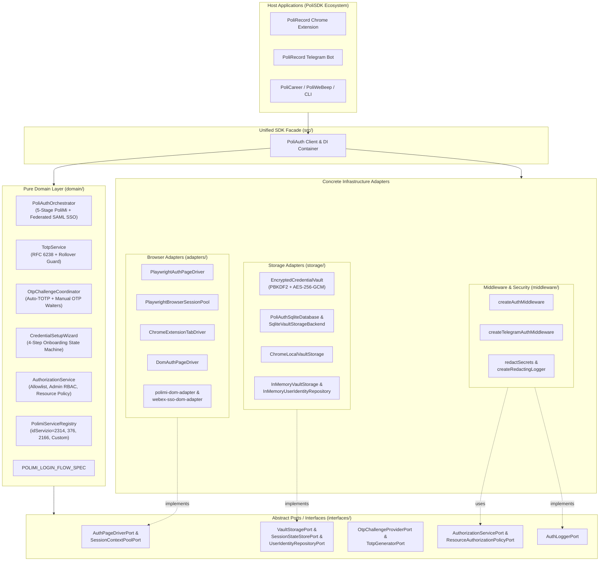

# Phase 2 & 3: Clean Architecture & Refactoring Strategy (`@polisdk/poliauth`)

## 1. Hexagonal (Ports & Adapters) Architecture

`@polisdk/poliauth` is structured around **Clean Architecture** and **Hexagonal Ports & Adapters**, ensuring the core authentication, 2FA TOTP, wizard, authorization, and state-machine orchestration logic has **zero dependencies** on concrete databases, browser automation frameworks, or chat/UI frameworks.

---

## 2. Application of SOLID & DDD Principles

1. **Single Responsibility Principle (SRP)**:
   - `TotpService` handles only RFC 6238/4226 Base32 decoding and HMAC-SHA1 code generation.
   - `OtpChallengeCoordinator` coordinates automatic TOTP derivation vs. manual 6-digit user waiters.
   - `PoliAuthOrchestrator` drives the 5-stage PoliMi JAF state machine and Federated Webex SAML SSO loop.
   - `EncryptedCredentialVault` handles PBKDF2-HMAC-SHA256 + AES-256-GCM encryption/decryption.
   - `polimi-dom-adapter` and `webex-sso-dom-adapter` perform pure DOM queries and form submissions without any course recording or MP4 player scraping.
2. **Open/Closed Principle (OCP)**:
   - New Politecnico di Milano services (`WeBeep`, `Carriera`, `Esami`, etc.) are added by registering a `PolimiPortalServiceDescriptor` in `PolimiServiceRegistry` without modifying `PoliAuthOrchestrator` or `polimi-dom-adapter`.
   - New resource authorization rules are plugged into `AuthorizationService` via `ResourceAuthorizationPolicyPort`.
3. **Liskov Substitution Principle (LSP)**:
   - `PlaywrightAuthPageDriver`, `ChromeExtensionTabDriver`, and `DomAuthPageDriver` all satisfy `AuthPageDriverPort` and can be swapped transparently in `PoliAuthOrchestrator`.
   - `SqliteVaultStorageBackend`, `ChromeLocalVaultStorage`, and `InMemoryVaultStorage` all satisfy `VaultStoragePort`.
4. **Interface Segregation Principle (ISP)**:
   - Storage ports are segregated into `VaultStoragePort` (key-value credential encryption), `SessionStateStorePort` (browser `storageState` persistence), and `UserIdentityRepositoryPort` (user profile and login status tracking).
5. **Dependency Inversion Principle (DIP)**:
   - High-level domain services (`PoliAuthOrchestrator`, `OtpChallengeCoordinator`, `AuthorizationService`) depend strictly on TypeScript interfaces in `interfaces/`, never on Playwright, SQLite, Chrome APIs, or grammY.

---

## 3. Key Refactorings Performed

### 3.1 Elimination of Triplicated Login State Machines
Previously, `executeAutomatedPolimiLogin` (`src/background/index.ts`), `ensureAuthenticatedArchivePage` (`src/bot/browser/polimi-session.ts`), and the mid-SAML loop in `WebexPlaywrightDownloader` (`src/bot/browser/webex-downloader.ts`) duplicated the 5-stage PoliMi login state machine.
- **Refactored**: Consolidated into `PoliAuthOrchestrator.authenticateToService()` and `PoliAuthOrchestrator.authenticateFederatedSaml()`, operating against any `AuthPageDriverPort`.

### 3.2 Thread-Safe Per-User Vault Key Derivation (Eliminating `globalThis.chrome` Mutation)
Previously, `polirecord/src/bot/db/vault-storage.ts` mutated `globalThis.chrome.runtime.id` inside a mutex so `src/shared/vault.ts` would derive a user-scoped PBKDF2 key.
- **Refactored**: `VaultStoragePort.getSecretMaterial?()` and `VaultCryptoOptions.secretMaterial` pass key material explicitly into `saveEncryptedCredentials` and `loadEncryptedCredentials` while producing the exact same `PoliRecord::VaultKey::v1::polirecord-telegram-bot-user-${id}-${keyFingerprint}::AES-256-GCM` key derivation string for 100% backward compatibility with existing `bot.sqlite` databases.

### 3.3 Separation of Pure Auth DOM Adapters from Application Scrapers
Previously, `src/adapters/polimi-adapter.ts` and `src/adapters/webex-adapter.ts` bundled course search table scraping and Webex MP4 download extraction together with SSO login forms.
- **Refactored**: Extracted `adapters/polimi-dom-adapter.ts` and `adapters/webex-sso-dom-adapter.ts` containing **only** authentication, 2FA, session recovery, portal service navigation, and SAML SSO identity brokering.

### 3.4 Preserved Critical Domain Invariants
All hard-won production invariants from live PoliMi and Webex debugging are preserved and covered by automated tests:
- **Stage 0 Security Violation Recovery**: Bare `/aunicalogin/` (`SessioneTerminataLogoutSSO.do` / `SessioneTerminata.do`) automatically recovers via `id_servizio=376`.
- **`sso_handoff` Priority over `credentials`**: `inspectPolimiPageStage` checks `form[action*="AunicaLogin.do"]` and `input[name="evn_checkCookieSSO"]` **before** `#login && #password` so auto-submitting SSO handoff pages are never mistaken for unauthenticated login forms.
- **Skipping Hidden JAF Submit Buttons**: Both Stage 1 (`button[name="evn_conferma"]:not(.jaf-visually-hidden)`) and Stage 2 (`button#submit-dissms[name="evn_continua"]`) skip `.jaf-visually-hidden` trap buttons.
- **Webex `#IDToken1` / `#IDButton2` Event Dispatch**: `submitWebexEmailLogin` dispatches `input`, `change`, and `blur` events on `#IDToken1` and removes `disabled` on `#IDButton2` before clicking.
- **TOTP Window Rollover Guard**: `generateStableTotp` waits for the next 30-second window when `<= 2s` remain so codes never expire mid-POST.
