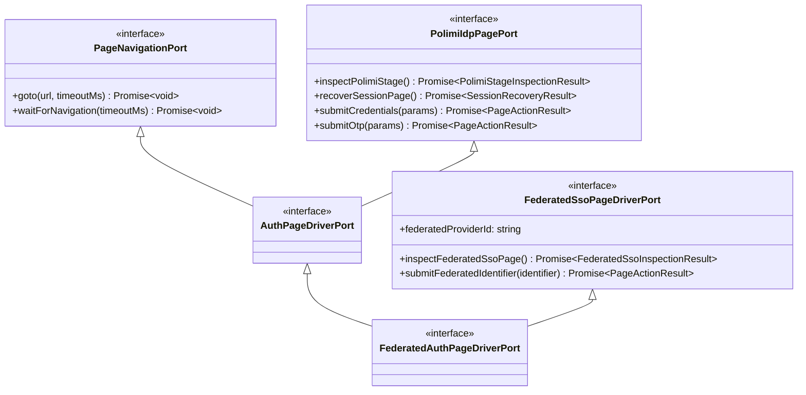

# Phase 4 — Interface & Extensibility Review

## 1. Executive Summary

In Phase 4, the interfaces across `@polisdk/poliauth` and its adapter packages were thoroughly audited and refactored to strictly enforce:
1. **Interface Segregation Principle (ISP)**: Monolithic contracts were segregated into cohesive role interfaces so callers and adapters depend only on the exact subset of methods they require.
2. **Open/Closed Principle (OCP)**: Service-provider-specific logic was completely decoupled from core domain specs. The core Politecnico di Milano IdP specification is closed to modification, while federated SAML Service Providers (Webex, Zoom, GitLab, Piazza, Microsoft 365) are open for extension via pluggable provider adapters and declarative specifications.
3. **Dependency Inversion Principle (DIP)**: Application use cases and orchestrators depend strictly on abstract ports, with zero knowledge of concrete DOM implementations, storage engines, browser automation tools, or chat frameworks.

---

## 2. Decoupling Webex from Core Domain (`POLIMI_LOGIN_FLOW_SPEC`)

Prior to Phase 4, `POLIMI_LOGIN_FLOW_SPEC` in `packages/poliauth/domain/login-flow-spec.ts` contained a `webexSsoPage` block with Cisco Webex-specific selectors (`#IDToken1`, `#IDButton2`, `idbroker-eu.webex.com`). This violated Clean Architecture and the Single Responsibility Principle by conflating PoliMi's Identity Provider with a single external consumer.

### Changes Made:
- **`POLIMI_LOGIN_FLOW_SPEC`** now strictly specifies Politecnico di Milano's Identity Provider:
  - `entry`: Portal entry URLs (`getservizio.xml?id_servizio=376`, `servizi-online`) and session-expired recovery selectors.
  - `credentialsPage`: Person code and password credentials form (`IdentificazioneUnica.do`, `aunicalogin.jsp`).
  - `otpPage`: 2FA OTP prompt (`form#form_scelta2fa`, `IdentificazioneDFA.do`).
  - `authenticatedSession`: Authenticated portal markers (`servizionline.polimi.it`, `.cercaServizio`).
  - `samlIdentityProvider`: PoliMi IdP transit hostnames (`aunicalogin.polimi.it`, `shibidp.polimi.it`, `idp.polimi.it`).
- **`WEBEX_SAML_FLOW_SPEC`** was moved to `packages/poliauth/adapters/webex-sso-dom-adapter.ts` as a concrete, pluggable federated Service Provider specification implementing `FederatedSsoProviderSpec`.

---

## 3. Segregated Port Hierarchies (ISP Compliance)

### 3.1 Browser Driver Ports (`interfaces/browser-driver-port.ts`)



- **`AuthPageDriverPort`**: Represents core PoliMi authentication capabilities (navigation + IdP credentials/2FA/recovery). Used by `PoliAuthOrchestrator.authenticate`.
- **`FederatedSsoPageDriverPort`**: Represents SAML Service Provider discovery capabilities. Decoupled from any particular service provider.
- **`FederatedAuthPageDriverPort`**: Combines both for multi-hop federated SSO flows (`PoliAuthOrchestrator.authenticateFederatedSaml`).

### 3.2 Pluggable Federated SAML Service Provider SPI (`interfaces/federated-sso-provider-port.ts`)

To support arbitrary SAML service providers without changing core code, a pluggable Service Provider Interface (SPI) was introduced:

```ts
export interface FederatedSsoProviderAdapterPort<TDocument = Document> {
  readonly providerId: string;
  readonly displayName: string;
  inspectPage(doc: TDocument, loc: PageLocationSnapshot): FederatedSsoInspectionResult;
  submitIdentifier(doc: TDocument, identifier: string): PageActionResult;
}
```

#### Declarative Specification Schema (`FederatedSsoProviderSpec`)
Most SAML Service Providers follow identical patterns (email prompt -> transit -> authenticated landing). Rather than writing imperative code for each provider, providers can be defined declaratively:

```ts
export interface FederatedSsoProviderSpec {
  providerId: string;
  displayName: string;
  identifierPrompt: {
    hostnames: readonly string[];
    pathnameSubstrings: readonly string[];
    identifierInputSelector: string;
    submitButtonSelector: string;
    formSelector?: string;
    contextualErrorSelector?: string;
    forceEnableSubmitButton?: boolean;
  };
  transitHostnames: readonly string[];
  transitUrlSubstrings: readonly string[];
  authenticatedHostnames: readonly string[];
  authenticatedSelectors?: readonly string[];
}
```

The generic `SelectorFederatedSsoProviderAdapter` executes any `FederatedSsoProviderSpec`. Providers are registered in the extensible `FederatedSsoProviderRegistry`.

### 3.3 Session Pool Ports (`interfaces/session-pool-port.ts`)

The previously monolithic `SessionContextPoolPort` was segregated into focused role interfaces:
- **`SessionContextLeasePort`**: Context acquisition, release, and primary page access (`acquireUserContext`, `releaseUserContext`, `getOrCreatePrimaryPage`).
- **`SessionContextPersistencePort`**: State saving (`saveUserContextState`).
- **`SessionContextDisposalPort`**: Context cleanup, eviction, and shutdown (`destroyUserContext`, `evictExpiredContexts`, `closeAll`).
- **`SessionPoolStatsPort`**: Telemetry and metrics (`getStats`).
- **`SessionContextPoolPort`**: Composite interface implemented by adapters such as `PlaywrightBrowserSessionPool`.

### 3.4 Storage & Key Derivation Ports (`interfaces/storage-port.ts`)

- **`VaultStoragePort`**: Pure key-value persistence (`get`, `set`, `remove`). Storage backends do not need to know about encryption keys.
- **`VaultSecretMaterialPort`**: Segregated role interface providing custom secret material for PBKDF2 key derivation (`getSecretMaterial()`). Implemented by `SqliteVaultStorageBackend` and `InMemoryVaultStorage`.
- **`UserIdentityRepositoryPort`**: Segregated into `UserIdentityProvisionerPort` (`ensureUser`), `UserIdentityReaderPort` (`getUser`, `listUsers`), and `UserIdentityWriterPort` (`updateUser`, `updateLoginStatus`, `deleteUser`).

### 3.5 Authorization Ports (`interfaces/authorization-port.ts`)

- **`AccessEvaluatorPort`**: Channel privacy and allowlist/admin evaluation (`evaluateChannelAndUserAccess`). The only contract required by bot/web middleware.
- **`SubjectRoleQueryPort`**: Role inspection (`isUserAllowed`, `isAdmin`).
- **`ResourceAuthorizerPort`**: Resource ownership and access evaluation (`authorizeResource`).
- **`ResourceAuthorizationPolicyPort`**: Pluggable policy interface for custom domain rules (`isResourceAuthorized`).

### 3.6 Two-Factor Authentication Ports (`interfaces/otp-provider-port.ts`)

- **`OtpCodeProviderPort`**: Resolves an OTP for login (`obtainOtpCodeForUser`). Used by `PoliAuthOrchestrator`.
- **`ManualOtpChallengePort`**: Interactive waiter lifecycle (`hasPendingOtpWaiter`, `submitManualOtpForUser`, `cancelPendingOtpWaiter`). Used by messaging/UI adapters.

---

## 4. Extensibility Guide: Registering Custom Adapters

### 4.1 Registering a Custom Federated SAML Service Provider (e.g. Zoom, GitLab)

```ts
import {
  FederatedSsoProviderRegistry,
  SelectorFederatedSsoProviderAdapter,
  DomFederatedAuthPageDriver,
  type FederatedSsoProviderSpec
} from '@polisdk/poliauth/adapters';

// 1. Define the declarative SAML SP specification
export const ZOOM_SAML_SPEC: FederatedSsoProviderSpec = {
  providerId: 'zoom',
  displayName: 'Zoom',
  identifierPrompt: {
    hostnames: ['polimi-it.zoom.us'],
    pathnameSubstrings: ['/signin'],
    identifierInputSelector: 'input#email',
    submitButtonSelector: 'button#btn-continue',
    forceEnableSubmitButton: false
  },
  transitHostnames: ['polimi-it.zoom.us', 'shibidp.polimi.it'],
  transitUrlSubstrings: ['/saml/sso'],
  authenticatedHostnames: ['zoom.us'],
  authenticatedSelectors: ['.zoom-profile-header']
};

// 2. Instantiate adapter and register it
const zoomAdapter = new SelectorFederatedSsoProviderAdapter(ZOOM_SAML_SPEC);
const registry = new FederatedSsoProviderRegistry([zoomAdapter]);

// 3. Bind to DomFederatedAuthPageDriver
const driver = new DomFederatedAuthPageDriver({
  getDocument: () => document,
  getLocation: () => window.location,
  provider: zoomAdapter
});
```

### 4.2 Implementing a Custom Storage Adapter (e.g. Redis, IndexedDB)

Implement `VaultStoragePort` (and optionally `VaultSecretMaterialPort` if providing tenant-specific key derivation):

```ts
import type {
  VaultStoragePort,
  VaultSecretMaterialPort
} from '@polisdk/poliauth/interfaces';

export class RedisVaultStorage implements VaultStoragePort, VaultSecretMaterialPort {
  constructor(private readonly redisClient: any, private readonly tenantKey: string) {}

  async get(keys: string | string[]): Promise<Record<string, unknown>> {
    const list = Array.isArray(keys) ? keys : [keys];
    const results: Record<string, unknown> = {};
    for (const key of list) {
      const val = await this.redisClient.get(`${this.tenantKey}:${key}`);
      if (val !== null) results[key] = JSON.parse(val);
    }
    return results;
  }

  async set(items: Record<string, unknown>): Promise<void> {
    for (const [k, v] of Object.entries(items)) {
      await this.redisClient.set(`${this.tenantKey}:${k}`, JSON.stringify(v));
    }
  }

  async remove(keys: string | string[]): Promise<void> {
    const list = Array.isArray(keys) ? keys : [keys];
    for (const key of list) {
      await this.redisClient.del(`${this.tenantKey}:${key}`);
    }
  }

  getSecretMaterial(): string {
    return this.tenantKey;
  }
}
```

---

## 5. Verification Matrix

| Verification Check | Target | Status |
| :--- | :--- | :--- |
| Core domain decoupled from Webex | Zero Webex references in `domain/login-flow-spec.ts` | Verified |
| ISP compliance on Driver Port | `AuthPageDriverPort` vs `FederatedAuthPageDriverPort` | Verified |
| OCP compliance on SAML Providers | Pluggable `FederatedSsoProviderAdapterPort` & `SelectorFederatedSsoProviderAdapter` | Verified |
| Backward compatibility maintained on adapters | `WebexSamlProviderAdapter` implements new port, helper functions intact | Verified |
| Storage & Session Pool ISP | Segregated interfaces with composite backwards-compatible ports | Verified |
| Typecheck across all 5 packages | 0 errors (`npm run typecheck`) | Verified |
| Vitest test suites | 10/10 test files, 42/42 tests passing (`npm test`) | Verified |
